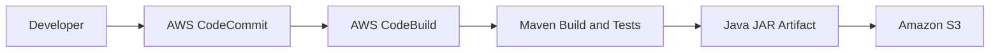

# CodeCommit Practice Lab

This repository is for learning AWS CodeCommit and Git.

## What I am learning

- Create and edit files
- Create Git branches
- Commit changes
- Push and pull changes
- Merge feature branches
# AWS CodeBuild Java Maven CI Build Lab

## Project Overview

This project demonstrates a basic Continuous Integration (CI) workflow using AWS CodeCommit, AWS CodeBuild, Maven, Java, and Amazon S3.

The pipeline retrieves Java source code from a Git repository, runs Maven tests, packages the application into a JAR file, and uploads the build artifact to Amazon S3.

## Architecture



## AWS Services and Tools

| Service / Tool | Purpose |
|---|---|
| AWS CodeCommit | Stores the source code in a Git repository |
| AWS CodeBuild | Runs the automated build process |
| Amazon S3 | Stores the generated build artifact |
| Java 11 / Amazon Corretto | Java runtime for the build |
| Apache Maven | Builds the application and runs tests |
| Git and Git Bash | Version control and command-line operations |
| Visual Studio Code | Source code editing |

## Project Structure

```text
codecommit-practice-lab/
├── src/
│   ├── main/
│   │   └── java/
│   │       └── MessageUtil.java
│   └── test/
│       └── java/
│           └── TestMessageUtil.java
├── buildspec.yml
├── pom.xml
├── .gitignore
└── README.md
```

## Build Process

1. Source code is committed and pushed to AWS CodeCommit.
2. AWS CodeBuild retrieves the source code from the configured branch.
3. The build environment prepares the required tools.
4. Maven runs the tests and packages the Java application.
5. CodeBuild collects the generated JAR file.
6. The build artifact is uploaded to Amazon S3.
7. The build logs and status can be reviewed in AWS CodeBuild and Amazon CloudWatch.

## Build Configuration

The `buildspec.yml` file defines the commands and artifact to be produced.

The main build command is:

```bash
mvn test package
```

The artifact configured for upload is:

```text
target/messageUtil-1.0.jar
```

## Prerequisites

- An AWS account with suitable IAM permissions
- AWS CLI configured for the lab environment
- Git installed
- Java and Maven knowledge
- An AWS CodeCommit repository
- An AWS CodeBuild project
- An Amazon S3 bucket for build artifacts

## Running the Build

### 1. Clone the repository

```bash
git clone <YOUR_CODECOMMIT_REPOSITORY_URL>
cd codecommit-practice-lab
```

### 2. Review the build configuration

Open `buildspec.yml` and `pom.xml` in Visual Studio Code.

### 3. Commit and push changes

```bash
git add .
git commit -m "Update Java CI build project"
git push
```

### 4. Start a CodeBuild build

Open the AWS Management Console and navigate to **CodeBuild**. Select the configured project and choose **Start build**.

### 5. Verify the results

Confirm that the build phases complete successfully and that the JAR artifact is uploaded to the configured S3 bucket.

## Validation

The successful lab build completed the following phases:

- Source download
- Install
- Pre-build
- Build
- Post-build
- Artifact upload
- Finalization

The generated artifact was verified in the configured S3 bucket.

## What I Learned

- Configuring an AWS CodeCommit repository
- Creating a Maven-based Java project
- Writing a CodeBuild `buildspec.yml` file
- Troubleshooting build failures and Maven configuration issues
- Configuring IAM permissions for AWS services
- Automating tests and packaging with Maven
- Uploading build artifacts to Amazon S3
- Using Git for source control

## Future Improvements

- Add automated build triggers for new commits
- Integrate code-quality checks
- Add a deployment stage using AWS CodeDeploy or another deployment service
- Introduce a complete CI/CD pipeline using AWS CodePipeline
- Add automated security and dependency scanning

## Important Note

This project demonstrates a **CI build and artifact-storage workflow**. It does not currently deploy the Java application to a running server.

## Author

Cloud Computing and DevOps Learning Portfolio

This project was created as a hands-on exercise in AWS, Java, Maven, Git, and CI automation.
